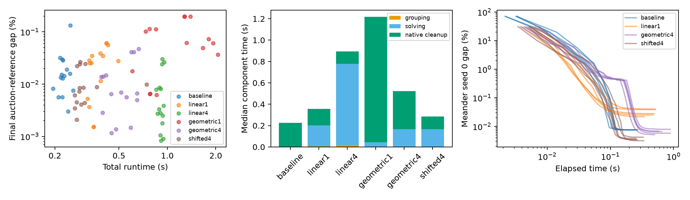

# Random cell groups: useful at small scale, not a replacement

**Recommendation: keep the current strided method.** Random cell groups can
improve the final numerical accuracy on the tested 40,000-point instances, but
that costs time, and the benefit did not carry over to the larger tests. This
experiment does not justify a package-default change or a paper revision.

The surprising part is that **shuffling indices was not the problem**. Building
and shuffling groups used roughly 1% of the best random variant's total runtime,
including at 1.28 million points. The expensive parts were the extra assignment
solves and the remaining local polishing.

## What was tested

The closest version of the proposal uses 1×1, 2×2, 3×3, … regions, shuffling each
region's cells into groups of at most 36 and solving those groups in parallel.
I also tried a shorter geometric schedule (1×1, 2×2, 4×4, …), one versus four
passes per level, and shifted region boundaries. All variants end with the same
production stride-1 cleanup. They share the initial random assignment, exact JV
kernel, improvement threshold, compiler, and thread count with the baseline.

The best compromise was **four shifted passes per geometric level** (`shifted4`):
unshifted, half-region horizontal shift, vertical shift, and both. Edges are
clipped, so shifted passes introduce smaller boundary regions. At the first
level, only the unshifted pass is truly global. This tests a combination of
random mixing and overlapping region scales, not randomness in isolation.

The primary experiment contains **450 runs**: five distribution families, three
instances per family, five grouping seeds, and six methods (the deterministic
baseline gets five timing repeats). Additional tests cover a two-pass variant,
independent initial assignments, larger grids, and alternative refinement rules.

## At 40,000 points: better final quality can cost more time

The following are medians across 15 instances, after reducing the five grouping
seeds or baseline timing repeats within each instance. Gaps are percentages of
the cached high-accuracy auction reference cost, not certified optimality gaps.

| Method | Runtime | Final reference gap |
|---|---:|---:|
| Current strided method | 0.223 s | 0.01448% |
| Linear regions, one pass | 0.348 s | 0.02793% |
| Linear regions, four passes | 0.914 s | 0.00334% |
| Geometric regions, one pass | 1.274 s | 0.06197% |
| Geometric regions, four passes | 0.516 s | 0.00665% |
| Geometric regions, four shifted passes | 0.286 s | 0.00847% |

The shifted variant gives a lower cost in **60 of 75 individual runs**, or
**13 of 15 instance-median comparisons**. Its median paired runtime increase is
28%; its median paired residual-gap reduction is 45%. The absolute improvement
is small: the table's gaps differ by about **0.006 percentage points**, not 45%
of total displacement cost. The seed spread is retained in `seed_spread.csv`.

Changing the initial permutation independently preserves this pattern: among
45 additional paired trials, shifted grouping improves cost in 31, with a median
30% smaller residual gap and 28% longer runtime. It is not simply a lucky match
to the package's default initial permutation.

Two shifted passes were not sufficient: in the focused comparison they improved
instance-median cost on only 4 of 15 instances and took about twice as long as
the baseline, because they left much more work for local polishing.

In the component chart, “native cleanup” includes the baseline's entire
multiscale solve; for the proposals it includes only their final local cleanup.
The trace panel shows one input instance and all five grouping/timing repetitions.
A random pass and a production round are different units of work.

## Larger grids: the small-scale benefit did not persist

These are meander instances, three per size, with one timing run per method and
instance. There is **no auction reference at these sizes**: quality is compared
directly with the current method's final cost.

| Points | Current runtime, median | Shifted random runtime, median | Shifted random final cost |
|---|---:|---:|---|
| 160,000 | 0.93 s | 1.23 s | Mixed: lower on 2/3, larger loss on the third |
| 640,000 | 4.84 s | 5.60 s | Higher on all 3; median +0.0038% |
| 1,279,161 | 12.13 s | 12.46 s | Higher on all 3; median +0.0070% |

There is no consistent large-scale time advantage. One 1.28-million-point input
is a favorable exception: 9.8 s versus 19.1 s, but with slightly higher final
cost. With only three inputs and no timing repeats at these sizes, this does not
establish a general speedup or slowdown.

The literal linear-region schedule was also tested on one instance per large
size. It took 2.19, 14.70, and 79.01 seconds respectively, with higher final costs
than the baseline on all three. The 1, 2, 3, … schedule spends too much work on
intermediate levels in this implementation.

At the largest size, the shifted variant spent about **0.13 s on group
construction/shuffling**, about **4.9 s on the random-group solves**, and the rest
mostly on local cleanup. Optimizing the shuffle alone would not change the
recommendation.

## Controls and interpretation

- Removing the shuffle from the shifted-region variant makes it a much worse
  optimizer: on the three tested 40k inputs it takes 6.6–25.7 s and finishes at
  0.34–0.59% reference gaps. Random mixing does matter within this construction.
- Repeating the current method's coarse-to-fine schedule twice costs about 31%
  more time but barely changes its final gaps (largest absolute change across
  15 inputs: 0.000031 percentage points). The small-grid random-group gain is
  not reproduced by simply repeating the same structured schedule.
- Local-only refinement from the random start takes 6–16 s and finishes much
  worse. The coarse stage is doing useful work.
- Using all 36 offsets at every production scale and during polishing improves
  cost on two of three tested inputs at substantially higher runtime. This is a
  separate, stronger neighborhood rule, not the package's optional single final
  all-offset sweep.

The evidence supports a limited small-grid quality lead, not a new default.
It does not identify whether random mixing, overlapping region boundaries, or
increased diversity of intermediate scales is the main cause. The regular
strided method remains the simpler, more reliable choice in these tests.

Early time-to-quality checkpoints do not establish a speedup either. Random
variants record after each pass, while production records after four-phase
rounds. That unequal resolution can explain small apparent timing differences.
The shifted variant reaches a 0.1% gap in all 75 small-grid runs, whereas the
baseline reaches it on 14 of 15 distinct inputs. The conclusions above use full
convergence times and final costs rather than claiming an early-stop speedup.

## Validation and scope

Every run checks bijectivity, independently recomputes assignment cost, and
checks monotone trace costs. The extracted C++ baseline reproduces all 15 stored
production reference gaps. Additional checks show identical assignments with
one and 24 threads and exact agreement with the installed production baseline
at 7×7, 40×40, and 200×200. All reported runs reached their configured convergence
criterion. The algorithm remains empirical: a local fixed point is not a global
optimum.

Fable reviewed the design, audited the prototype and results, and agreed with
keeping the current method. Its feedback prompted the no-shuffle and repeated-
schedule controls, per-seed reporting, and more careful time-to-quality and
large-grid language. The tests use square, fully occupied grids; masks,
rectangular grids, MNIST, and billion-point behavior were not evaluated here.
The prototype also materializes extra O(n) cell/group indices that production
avoids. Both methods were compiled together for this experiment; these timings
should not be substituted for the paper's historical measurements.

The paper and published package are unchanged. `README.md` documents reproduction;
JSONL files retain complete traces, and CSV files provide per-family, per-seed,
and scaling summaries.
